layout: true

<!-- <div class="my-footer"> -->
<!-- <span> -->
<!-- &emsp;&emsp;&emsp;&emsp;&emsp;&emsp;&emsp;&emsp;&emsp;&emsp; -->
<!-- &emsp;&emsp;&emsp;&emsp;&emsp;&emsp;&emsp;&emsp;&emsp;&emsp; -->
<!-- &emsp;&emsp;&emsp;&emsp;&emsp;&emsp;&emsp;&emsp;&emsp;&emsp; -->
<!-- &emsp;&emsp;&emsp;&emsp;&emsp; -->
<!-- <a href="https://federicomarini.github.io/ULBSingleCellMeetup/"><code>https://federicomarini.github.io/ULBSingleCellMeetup/</code></a> -->
<!-- </span> -->
<!-- </div> -->

```{r htmltools, include=FALSE}
stopifnot(requireNamespace("htmltools"))
htmltools::tagList(rmarkdown::html_dependency_font_awesome())
```


```{r setup, include=FALSE}
options(htmltools.dir.version = FALSE)
knitr::opts_chunk$set(
  eval = TRUE,
  message = FALSE,
  echo = FALSE,
  warnings = FALSE,
  fig.align = "center"
)
```


---

# About me

--

Hi, I am Federico  
Group leader, Bioinformatics at the IMBEI, Unimedizin Mainz ("come for the view - stay for the science")

--

I am normally busy with the development of **methods and software for interactive and reproducible research**
  - Data visualization and exploration
  - Advanced modeling
  - Interpretation and contextualization

--

We do...

* **Transcriptome data analysis** & other omics assays (ATAC-seq, ChIP-seq, ...)

* Development of **methods/software** and **web-based applications** for data analysis

* Integration of **different omics layers** at different scales, with clinical covariates, **streamlining processes** with (hopefully) clever infrastructure solutions


--

You can find this presentation here: [`https://github.com/imbeimainz/2026_PhysaliaCourses_iSEE`](https://github.com/imbeimainz/2026_PhysaliaCourses_iSEE)

<!-- [`https://federicomarini.github.io/RMCR2021/`](https://federicomarini.github.io/RMCR2021/)<br> -->
<!-- [`https://bit.ly/iSEE_RMCR`](https://bit.ly/iSEE_RMCR) -->

<!-- .vlarge[1) Better exploration, of data AND results] -->

<!-- .vlarge[2) Extraction of additional layers of information (from the same data)] -->

<!-- .vlarge[3) Integration of different analyses and network based information] -->

<!-- .vlarge[4) Better communication and reachout] -->

---

background-image: url("images/marie.png")
background-size: cover
background-position: 50% 50%
class: center, bottom, inverse

--

# Does the 

# **exploration**

# of your data spark joy?

---

background-image: url("images/marie.png")
background-size: cover
background-position: 50% 50%
class: center, bottom, inverse

# Does the 

# **exploration AND interpretation**

# of your data spark joy?

---

background-image: url("images/console_logcounts_sparse.png")
background-size: contain
background-position: 50% 50%
class: middle, center

# (Interactive) Exploration and visualization: why?

Effective and efficient methods are key to deliver...

--

`r fontawesome::fa('check')` better **quality assessment**

--

`r fontawesome::fa('check')` better **generation of research hypotheses**

--

`r fontawesome::fa('check')` better **representation of the results**

--

`r fontawesome::fa('check')` better **communication** of findings

--

<!-- Most of you might be familiar with `CELLxGENE`...   -->

## Where do we stand?

--

`r fontawesome::fa('brain')` The data is **large** ("can't fit in our head")  
`r fontawesome::fa('question')` Our task is **complex**  
`r fontawesome::fa('exclamation')` The Pro & the Con: **We are not alone**, we work with a variety of experts  
`r fontawesome::fa('lightbulb')` Proper analysis tools _should_ combine **interactivity and reproducibility**

<!-- - use structures/containers that support alternative (out-of-memory) representations -->
<!-- - yet we are curious and stubborn enough that we want to try and understand this -->
<!-- - mind (and bridge) the gap when **communicating**! -->
<!-- ### Proper analysis tools _should_ combine **interactivity and reproducibility** -->

---

## `pcaExplorer` and `ideal`: exploring and modeling RNA-seq data

Nowadays it takes more than just two to tango!

--

<p align="center">
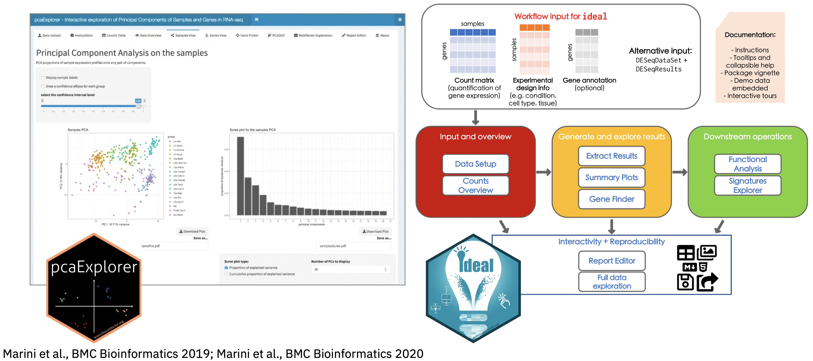
</p>

---

# I've seen things you people wouldn't believe

--

<p align="center">

</p>

*Collaborative effort - Oil on canvas*

---

## `GeneTonic`: Better exploration & interpretation, of data AND results

<p align="center">
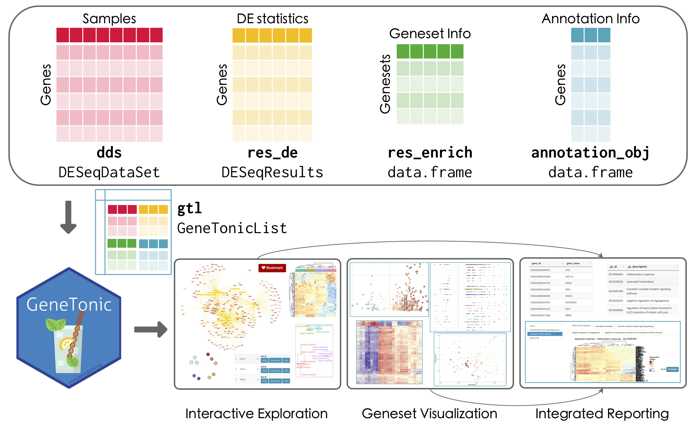
</p>

Marini et al., BMC Bioinformatics (2021); Ludt et al., Current Protocols (2022)

---

## `SummarizedExperiment`/`SingleCellExperiment`

<p align="center">
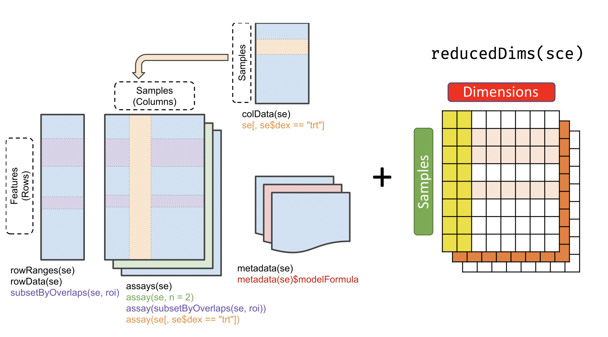
</p>

<!-- Thank you Martin Morgan!!! -->

<!-- or the one from the OSCA paper? -->

--

It can store [**RNA-seq**|DNA methylation|Hi-C|Microarray|Mass cytometry|SNPs] data

Excellent primer on single cell data analysis I contributed to:  [`https://osca.bioconductor.org`](https://osca.bioconductor.org)!

<!-- iSEE focuses on the SingleCellExperiment class. -->
<!-- This class stores all the data and metadata associated with assays, cells, and features. -->

<!-- SingleCellExperiment usage in a workflow -->

<!-- The SingleCellExperiment class is designed to accomodate all the information produced along a typical single-cell analysis workflow. -->

---

# Designing `iSEE`: Looking for a silver bullet

Data exploration is crucial: 

- No general tool for doing this **interactively**, limited to assay types or analysis steps
- No support for **reproducibility**, while keeping it intuitive and usable

--

Joint work with Aaron Lun, Charlotte Soneson, Kevin Rue-Albrecht initiated at [#EuroBioc2017](https://twitter.com/hashtag/EuroBioC2017)

<p align="center">


</p>

--

`"We could have an interactive SummarizedExperiment Explorer tool..."`

--

## Any early users in the audience?

<!-- Visualize my data in any (precomputed) reduced dimension space. -->
<!-- Color the data points with any experimental covariate (e.g. batch). -->
<!-- Color the data points with any expression data. -->
<!-- Select data points in a plot, and highlight them in another. -->
<!-- Visualize the distribution of any assay or metadata. -->
<!-- Visualize the correlation between gene A and gene B, specifically in ‘this’ or ‘that’ cluster -->

<!-- Fully empower the data generators - and get lazy! -->

---

background-image: url("images/manycommitsago.png")
background-size: contain
background-position: 50% 50%
class: center, bottom

# > 3000 commits ago...

[`https://github.com/iSEE/iSEE/tree/021e3e20cfdb194e511f8097ed544329bd46bcd6`](https://github.com/iSEE/iSEE/tree/021e3e20cfdb194e511f8097ed544329bd46bcd6)

---

class: animated, tada

# Hello `iSEE`

<p align="center">

</p>

* [`https://f1000research.com/articles/7-741/v1`](https://f1000research.com/articles/7-741/v1), live apps inside
* Available in Bioconductor [`https://bioconductor.org/packages/iSEE/`](https://bioconductor.org/packages/iSEE/)
* `r emo::ji("champagne")` [`https://blog.rstudio.com/2019/04/05/first-shiny-contest-winners`](https://blog.rstudio.com/2019/04/05/first-shiny-contest-winners) `r emo::ji("champagne")`

---

class: bottom

background-image: url("images/iSEEmeme.jpg")
background-size: contain
background-position: 50% 50%

--
<!---->
## Using iSEE is easy as

# `iSEE(sce)`

`r emo::ji("crossed_fingers")`

---

# `iSEE` `r emo::ji("heart")` SingleCellExperiment

<p align="center">
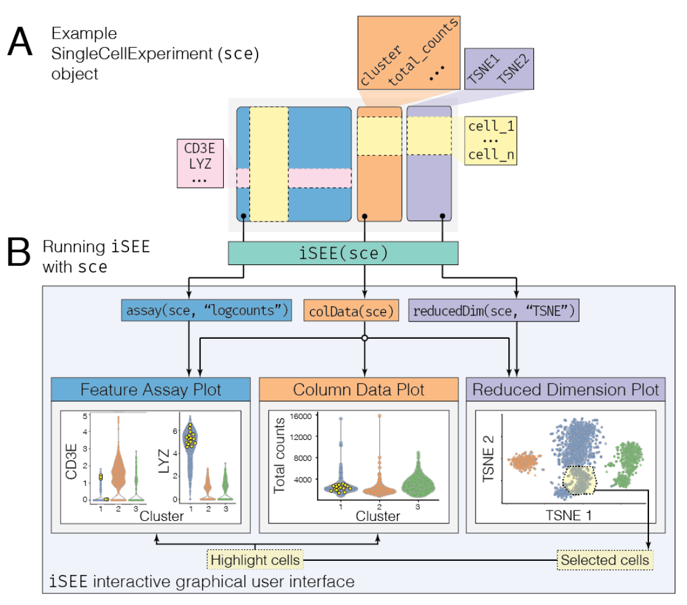
</p>

---

# `iSEE` in action: the *Tabula Muris* dataset

.pull-left[
<p align="center">

</p>
]

.pull-right[
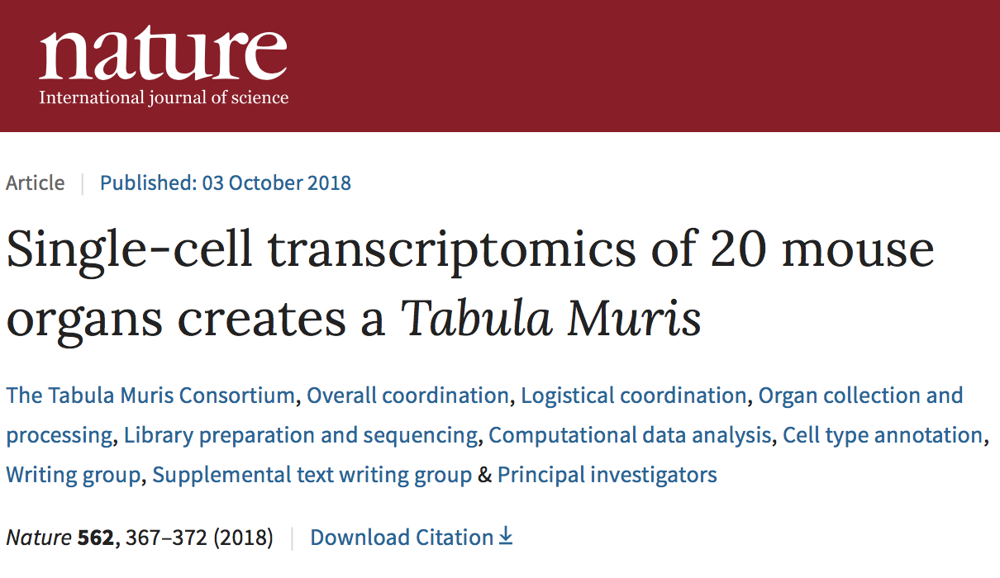
]

--

Preprocessing details + `iSEE` configuration for this set can be found at 
[`https://github.com/iSEE/iSEE_instances`](https://github.com/iSEE/iSEE_instances/tree/master/iSEE_tabulamuris)

- 20 organs and tissues, from 8 different mice
- 23036 genes
- 43598 cells $\rightarrow$ >1 billion data points


---

class: center, bottom

# A tour of the panels: think of *any* visualization type...

---

background-image: url("images/tm_isee_allpanels.png")
background-size: contain
background-position: 50% 50%
class: center, bottom

# A tour of the panels: think of *any* visualization type...

---

background-image: url("images/ss_reddim.png")
background-position: 50% 50%
background-size: contain
class: center, animated, zoomInLeft

---

background-image: url("images/tm_isee_allpanels.png")
background-size: contain
background-position: 50% 50%
class: center, animated, fadeIn

---

background-image: url("images/ss_featassay.png")
background-size: contain
background-position: 50% 50%
class: center, animated, zoomIn

---

background-image: url("images/tm_isee_allpanels.png")
background-size: contain
background-position: 50% 50%
class: center, animated, fadeIn

---

background-image: url("images/ss_samplesassay.png")
background-size: contain
background-position: 50% 50%
class: center, animated, zoomInRight

---

background-image: url("images/tm_isee_allpanels.png")
background-size: contain
background-position: 50% 50%
class: center, animated, fadeIn

---

background-image: url("images/ss_coldata_rowdata.png")
background-size: contain
background-position: 50% 50%
class: center, animated, zoomInUp

---

background-image: url("images/tm_isee_allpanels.png")
background-size: contain
background-position: 50% 50%
class: center, animated, fadeIn

---

background-image: url("images/ss_tables.png")
background-size: contain
background-position: 50% 50%
class: center, animated, zoomInUp

---

background-image: url("images/tm_isee_allpanels.png")
background-size: contain
background-position: 50% 50%
class: center, animated, fadeIn

---

# I have got a quiz for you!

--

**Question 1**

How many lines of code are required to realize this?

--

A) 4-5  
B) 250-300  
C) 7500-10000  

---

# I have got a quiz for you!

**Question 1**

How many lines of code are required to realize this?

A) 4-5  
**B) 250-300**  
C) 7500-10000  

--

**Question 2**

How many of these lines had to be typed by a human?

A) 4-5  
B) 250-300  
C) 7500-10000  

---

# I have got a quiz for you!

**Question 1**

How many lines of code are required to realize this?

A) 4-5  
**B) 250-300**  
C) 7500-10000  

**Question 2**

How many of these lines had to be typed by a human?

**A) 4-5**  
B) 250-300  
C) 7500-10000  

--

I am not a magician, so I will explain you all about the trick...

---

class: center, bottom, fadeIn

# Flexibility and customizability

---

background-image: url("images/gif_bsb2.gif")
background-size: contain
background-position: 50% 50%
class: center, bottom, fadeIn

# Flexibility and customizability

---

background-image: url("images/gif_reordering.gif")
background-size: contain
background-position: 50% 50%
class: center, bottom

# Reordering the panels - `iSEE`ing exactly what you want

---

background-image: url("images/tm_isee_reorderedpanels.png")
background-size: contain
background-position: 50% 25%
class: center, bottom

# Reordering the panels - `iSEE`ing exactly what you want

---

background-image: url("images/gif_colorbygene.gif")
background-size: contain
background-position: 50% 50%
class: center, bottom

# Augmenting the observed data with biological knowledge

---

background-image: url("images/gif_linkedtotable.gif")
background-size: contain
background-position: 50% 50%
class: center, bottom

# Linking the panels: going down the rabbit hole

---

background-image: url("images/gif_customde.gif")
background-size: contain
background-position: 50% 50%
class: center, bottom

# Designing custom panels to extend `iSEE`'s functionality

---

class: center, bottom

# Working in a reproducible way

---

background-image: url("images/meme_owl.jpg")
background-size: contain
background-position: 50% 50%
class: center, bottom

# Working in a reproducible way

<!-- - "Oh, code..." -->

---

background-image: url("images/gif_reprocode.gif")
background-size: contain
background-position: 50% 50%
class: center, bottom

# Meta-generating code: our solution for full reproducibility

<!-- ### `knit` me baby one more time -->

---

background-image: url("images/meme_gandalf.jpg")
background-size: contain
class: center, bottom

---

<!-- Markers: Pax9, Olig1, Cd68 -->

background-image: url("images/gif_toursteps.gif")
background-size: contain
background-position: 50% 50%
class: center, bottom

# Interactive tours: an efficient means to communicate

---

# Taking the express ticket to exploration: `iSEEfier`

`iSEEfier`, work by **Najla Abassi**

--

<p align="center">
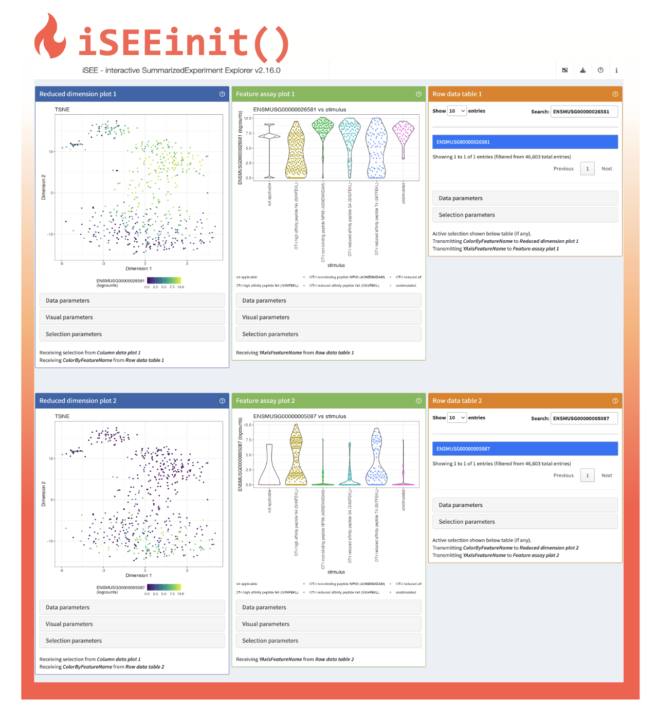
</p>

---

# Taking the express ticket to exploration: `iSEEfier`

`iSEEfier`, work by **Najla Abassi**

.pull-left[
<p align="center">
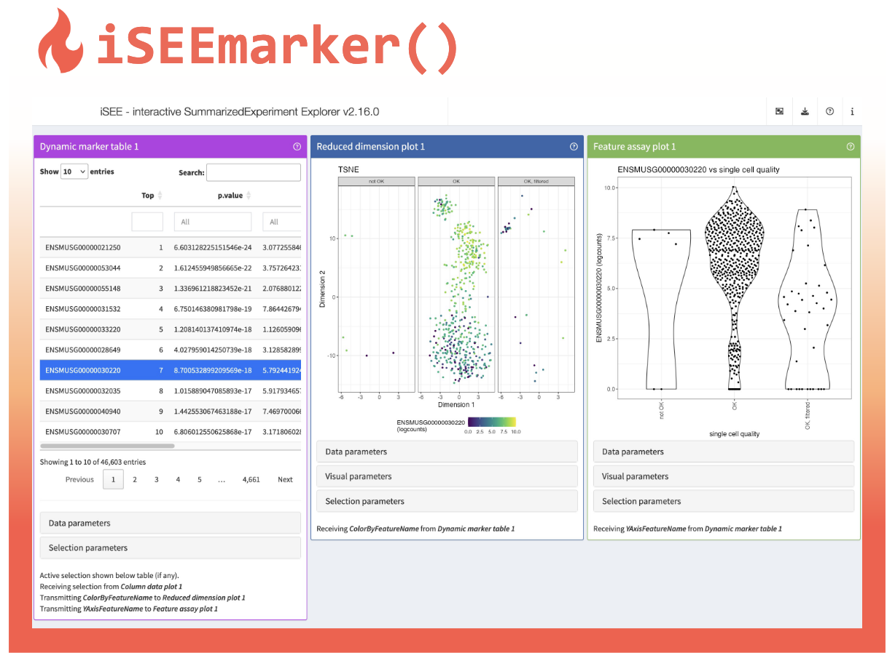
</p> 
]

.pull-right[
`iSEEfier` significantly reduces the time and effort required to set up iSEE sessions  
Got some configurations you would like to see covered? Just reach out!

`iSEE`, `iSEEfier` and more packages are available on Bioconductor!
]

---

# Achieving better communication and reachout

--

`iSEE` large collections of datasets - with **Ramon Massoni Badosa**

<p align="center">
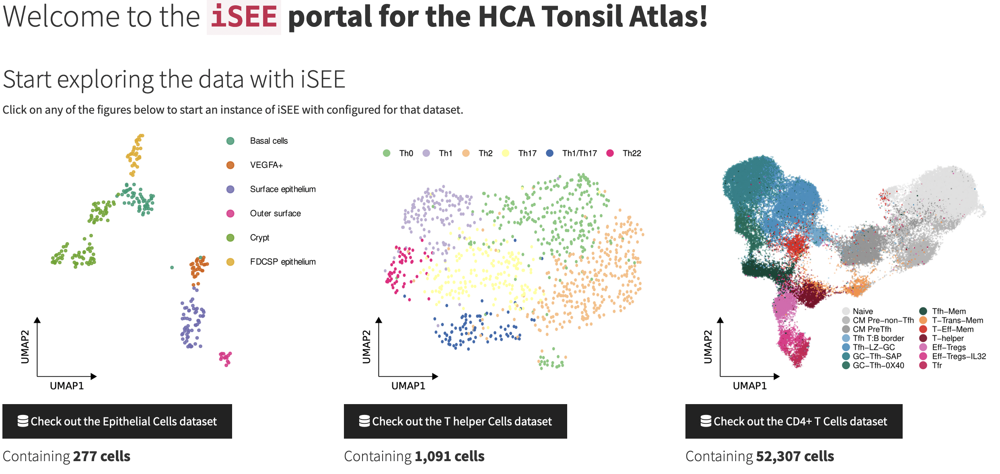
</p>

[`https://shiny.imbei.uni-mainz.de/iSEE_TonsilDataAtlas/`](https://shiny.imbei.uni-mainz.de/iSEE_TonsilDataAtlas/) + [`https://bioconductor.org/packages/iSEEhub/`](https://bioconductor.org/packages/iSEEhub/)

---

# `iSEEindex` powering collections of datasets

--

<p align="center">
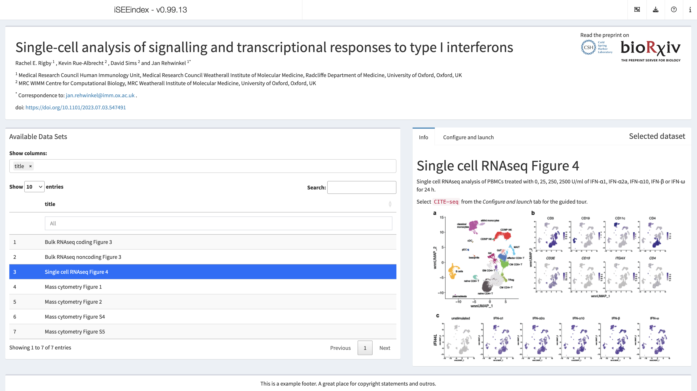
</p>

[`https://rehwinkellab.shinyapps.io/ifnresource/`](https://rehwinkellab.shinyapps.io/ifnresource/)

More examples: https://isee.github.io/apps.html

---

# `iSEEid` - need some help in annotating single cells?

--

<p align="center">
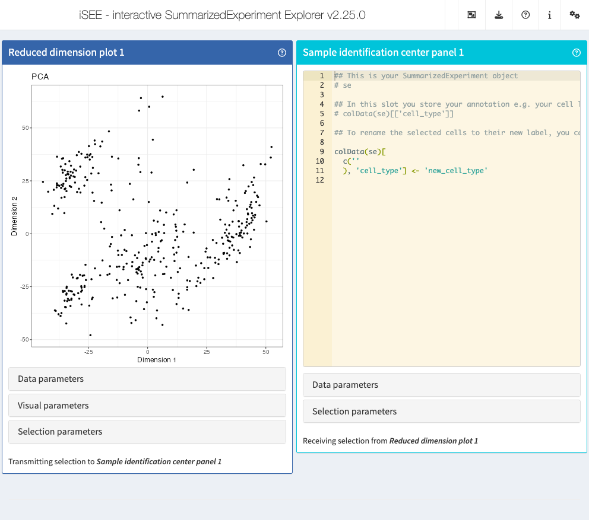
</p>

[`https://bioconductor.org/packages/iSEEid`](https://bioconductor.org/packages/iSEEid)

---

# We want you to use `iSEE`!

--

... which is why there is [`https://isee.github.io/iUSEiSEE/`](https://isee.github.io/iUSEiSEE/)

--

<p align="center">
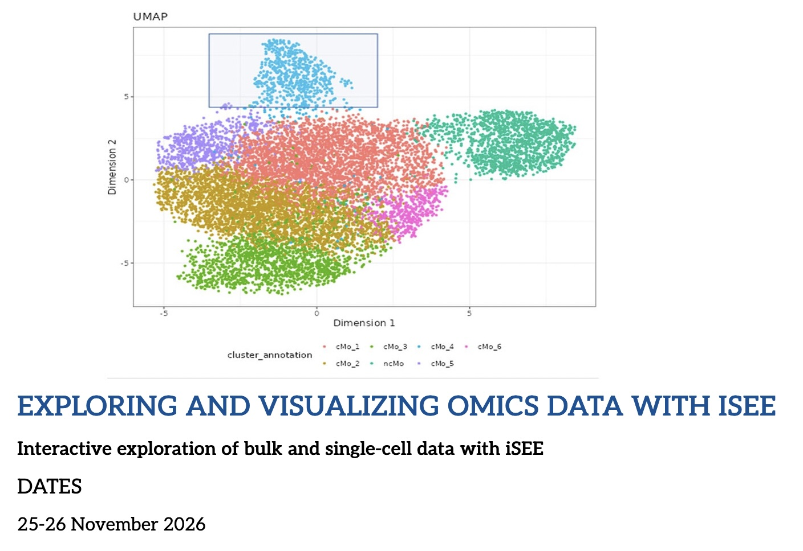
</p>

[`https://www.physalia-courses.org/courses-workshops/isee/`](https://www.physalia-courses.org/courses-workshops/isee/)

---

# A few funny/useful things about `iSEE`

--

* We have modes and additional panels (starting from `iSEEu` and making the whole `iSEEverse`...) to extend its functionality

--

* `iSEE` has also some specific panels for microbiome data (via `iSEEtree`)

--

* `iSEEde` and `iSEEpathways` - working like a charm on any bulk RNA-seq dataset!

--

* You can use `iSEE` pretty much for any dataset/data type (phosphoproteome, I did not see that one coming...)! - Yes, even spatial transcriptomics!

--

* You can use `iSEE` as a local mini-server - `iSEE(sce)` $\rightarrow$ `iSEE()`

--

* We are not alone in the "exploration business": [`https://github.com/federicomarini/awesome-expression-browser`](https://github.com/federicomarini/awesome-expression-browser) keeps track of the many existing solutions

--

* You can control `iSEE` with your voice

---

## `iSEE(sce, voice = TRUE)`

<iframe width="900" height="500" src="https://www.youtube-nocookie.com/embed/0crFZLwAJOE" frameborder="0" allow="accelerometer; autoplay; encrypted-media; gyroscope; picture-in-picture" allowfullscreen></iframe>

<!-- Easter eggs included! -->

---

# `iSEE`, from zero to hero

What do you need?

--

1. Your data - preprocessed, annotated; ready for submission, or for lab meeting progress report.  
   Format: SingleCellExperiment; Seurat, Scanpy are just one conversion step away!

--

1. Install `iSEE` once, with `BiocManager::install("iSEE")`

--

1. Launch `iSEE`, with `iSEE(sce)`

--

1. Explore, design, create compelling visualizations, tailor up the manuscript story  
   $\rightarrow$ Copy-paste in notebooks configs and code

--

1. Publish/deploy your dataset to be fully explored   
   [`https://shiny.imbei.uni-mainz.de/iSEE_KDM6B_inhibition/`](https://shiny.imbei.uni-mainz.de/iSEE_KDM6B_inhibition/)

--

More examples? Check out [`https://isee.github.io/apps.html`](https://isee.github.io/apps.html) and [`https://github.com/iSEE/iSEE_instances/`](https://github.com/iSEE/iSEE_instances/) for inspiration!

---

# Proudly brought to you by...

--

<p align="center">
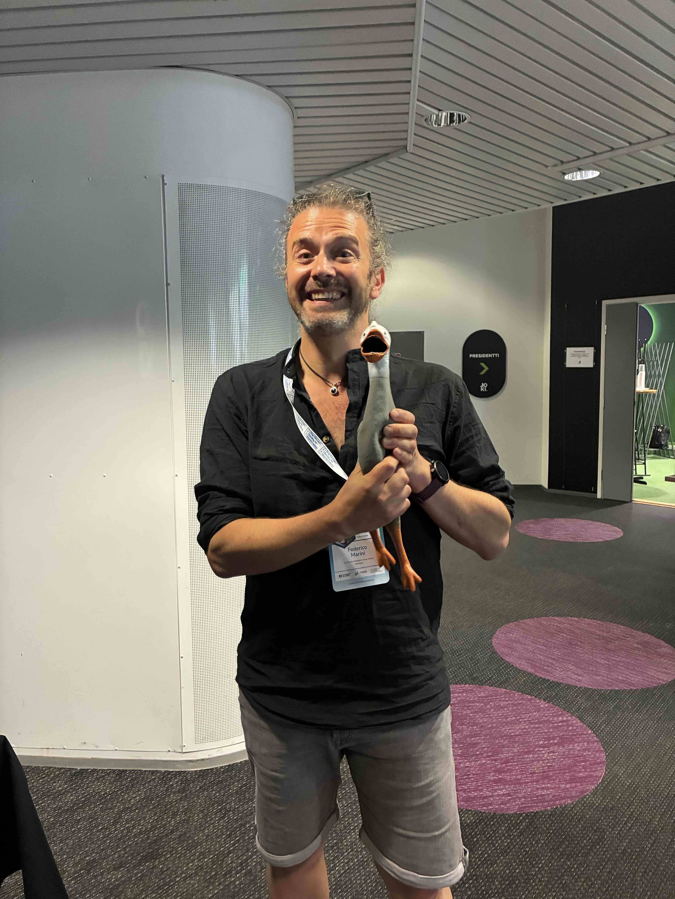
</p>

---

# You have seen/will see these packages in action

- [`https://bioconductor.org/packages/pcaExplorer/`](https://bioconductor.org/packages/pcaExplorer/)
- [`https://bioconductor.org/packages/ideal/`](https://bioconductor.org/packages/ideal/)
- [`https://bioconductor.org/packages/GeneTonic/`](https://bioconductor.org/packages/GeneTonic/)
- [`https://bioconductor.org/packages/iSEE/`](https://bioconductor.org/packages/iSEE/)
- [`https://bioconductor.org/packages/iSEEu/`](https://bioconductor.org/packages/iSEEu/)
- [`https://bioconductor.org/packages/iSEEde/`](https://bioconductor.org/packages/iSEEde/)
- [`https://bioconductor.org/packages/iSEEpathways/`](https://bioconductor.org/packages/iSEEpathways/)
- [`https://bioconductor.org/packages/iSEEindex/`](https://bioconductor.org/packages/iSEEindex/)
- [`https://bioconductor.org/packages/iSEEhub/`](https://bioconductor.org/packages/iSEEhub/)
- [`https://bioconductor.org/packages/iSEEtree/`](https://bioconductor.org/packages/iSEEtree/)
- [`https://bioconductor.org/packages/iSEEfier/`](https://bioconductor.org/packages/iSEEfier/)
- [`https://bioconductor.org/packages/iSEEid/`](https://bioconductor.org/packages/iSEEid/)

--

All of them are **free**, **open source**, there for you to **use them**!

--

Wanna install all things iSEE in one go? Enter the [`iSEEverse`](https://github.com/iSEE/iUSEiSEE/)

`remotes::install_github("iSEE/iSEEverse")`

---

# Lessons learned along the journey - "why bother?"

--

* I've seen too many realizations of the _Anna Karenina principle for data analysis_ - and we have to do something to **get to the insight** you seek!

--

* I've been working in **fantastic (and challenging) interdisciplinary environments**, where people with different expertise come into play: We need platforms to foster this!

--

* There is a lot of beauty in using **community established standards** - datasets are not getting any less complex!

--

* Using standard interoperable frameworks takes you just **one step away from using our tools & packages**

--

* Accompanying your publications with **live explorable versions of your data** helps you tell a good story, promotes open science, and fosters new viewpoints from other scientists

---

background-image: url("images/group_pic.jpg")
background-size: cover
background-position: 50% 50%
class: center, bottom, inverse

<!-- -- -->

My research group & the **`iSEE` development team** & Bioc Community `r emo::ji("heart")`

--

## ... thank you for your attention!

<code>`r fontawesome::fa("paper-plane")` marinif@uni-mainz.de - `r fontawesome::fa('bluesky')`</code> [`@federicomarini.bsky.social`](https://federicomarini.bsky.social)<br>
<br>

<!-- -- -->

<!-- This presentation: [`https://bit.ly/CZI_iSEE`](https://bit.ly/CZI_iSEE)<br> -->
<!-- [`https://federicomarini.github.io/cziSEE/`](https://federicomarini.github.io/cziSEE/) -->

---

# Time to get our hands dirty!

Let's navigate to https://github.com/iSEE/iUSEiSEE/ - rendered at https://iSEE.github.io/iUSEiSEE. This is the "official" full documentation to learn how to use iSEE.

If desired: Clone it locally/download as zip and unpack it:  
[`https://github.com/iSEE/iUSEiSEE/`](https://github.com/iSEE/iUSEiSEE/) --> `git clone git@github.com:iSEE/iUSEiSEE.git`

Clone this repo on top - contains the presentation and the template for the exercises (URL: https://github.com/imbeimainz/2026_PhysaliaCourses_iSEE, clone it via `git clone git@github.com:imbeimainz/2026_PhysaliaCourses_iSEE.git`)

Start using the `2026_PhysaliaCourses_iSEE.Rproj` file in it!


